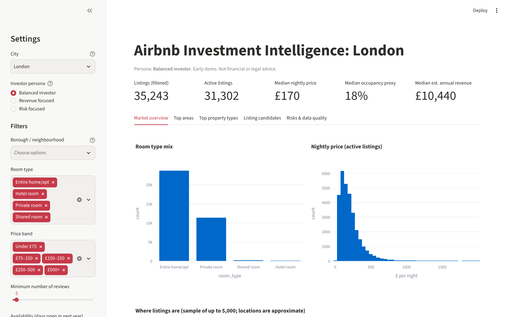
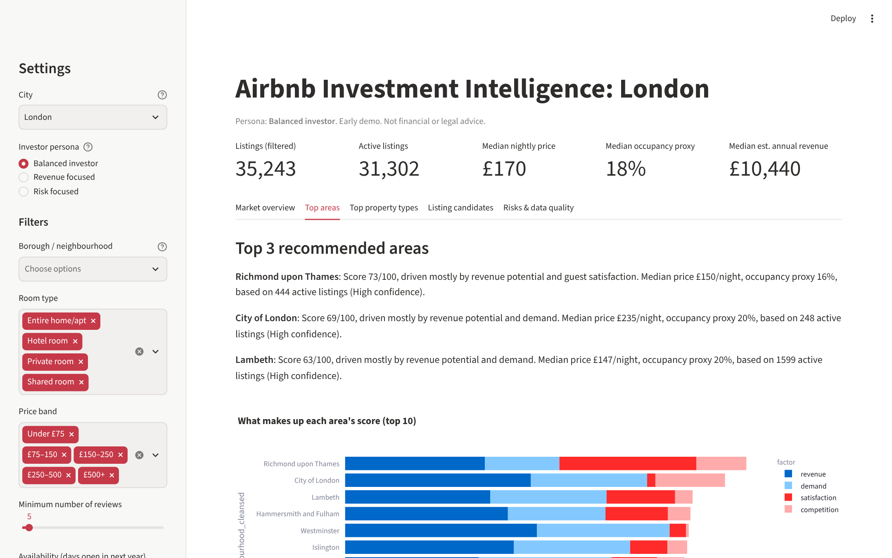
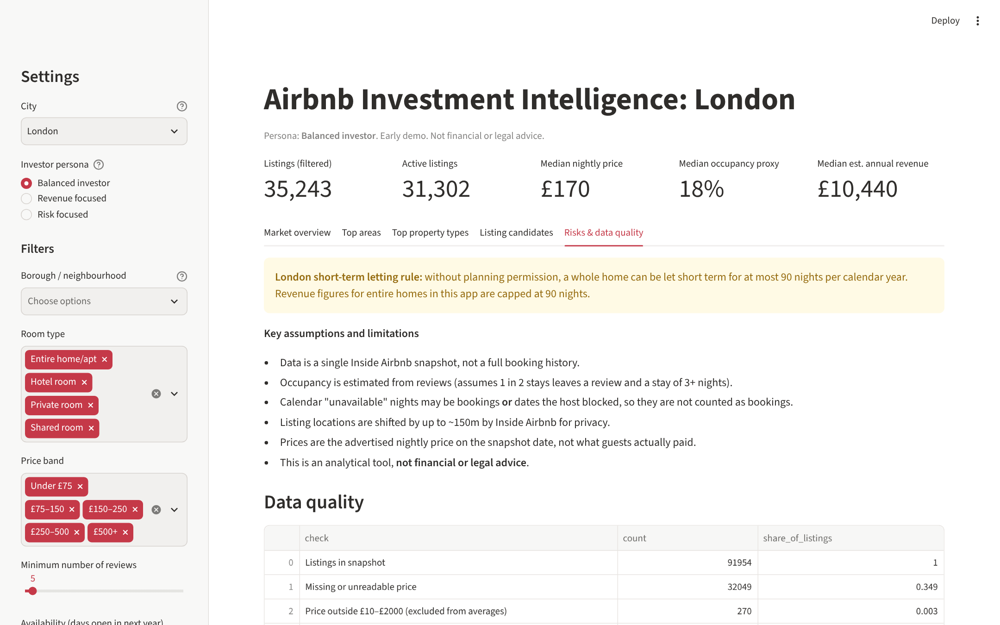

# Airbnb Investment Intelligence App

A Streamlit app that helps a property investor decide **where**, **what** and **how** to invest in short-term rental property in UK cities, using [Inside Airbnb](https://insideairbnb.com/get-the-data/) data. London is the required baseline. The app ranks boroughs and property types with a **transparent investment score**, explains every recommendation, and states the risks and assumptions behind it.

> **Status:** early demo (Rockborne Advance project, weeks 7–8 checkpoint, 20 Nov 2026).
> **Not financial or legal advice.**



---

## Contents
- [The problem](#the-problem)
- [What the app does](#what-the-app-does)
- [First results for London](#first-results-for-london)
- [How it works](#how-it-works)
- [Key assumptions](#key-assumptions)
- [Run it locally](#run-it-locally)
- [Project structure](#project-structure)
- [Testing and CI](#testing-and-ci)
- [Datasets](#datasets)
- [Roadmap](#roadmap)
- [Documentation](#documentation)
- [Team](#team)

---

## The problem
A property investor wants to buy a UK property to run as an Airbnb. They need to know which area to buy in, what type of property to buy, and what it might realistically earn, including the legal and data risks. They want something they can explore and question, not a static report.

**Personas.** The user picks one of three investor personas, which changes how the score weighs each factor:

| Persona | Revenue | Demand | Guest satisfaction | Low competition |
|---|---|---|---|---|
| Balanced investor | 35% | 25% | 25% | 15% |
| Revenue focused | 50% | 30% | 10% | 10% |
| Risk focused | 20% | 25% | 35% | 20% |

---

## What the app does

| Feature | Details |
|---|---|
| City selector | London (built), Bristol, Edinburgh, Greater Manchester (shown once their data is processed) |
| Persona selector | Balanced, revenue focused, risk focused |
| Filters | Borough, room type, price band, minimum reviews, availability |
| Key metrics | Listings, active listings, median nightly price, occupancy proxy, estimated annual revenue |
| Market overview | Room type mix, price distribution, map of listings |
| **Top 3 areas** | Ranked by investment score, each with an explanation and a chart of how many points each factor contributed |
| **Top 3 property types** | Room type × bedroom group, ranked and explained |
| **Listing candidates** | Real, well-reviewed, high-earning listings as examples of strong performance (not properties for sale) |
| Top vs bottom comparison | Average of the 5 best and 5 worst areas |
| Risks and data quality | London 90-night rule, assumptions, limitations, data-quality counts |

| Top areas and score breakdown | Risks and data quality |
|---|---|
|  |  |

---

## First results for London
Inside Airbnb snapshot from **17 September 2026**: 91,954 listings, of which ~40,000 are active with a valid price. Balanced investor, listings with 5+ reviews:

| Rank | Borough | Score | Median price | Occupancy proxy | Median est. revenue |
|---|---|---|---|---|---|
| 1 | Richmond upon Thames | 73 | £150 | 16% | £10,140 |
| 2 | City of London | 69 | £235 | 20% | £15,289 |
| 3 | Lambeth | 63 | £147 | 20% | £10,170 |

- **Top 5 vs bottom 5 areas:** median price £195 vs £93, occupancy 19% vs 14%, revenue £12.8k vs £5.3k a year. Ratings are nearly identical (4.73 vs 4.71), so **price and demand drive the gap, not guest satisfaction**.
- **The persona changes the answer.** Revenue focused: City of London, Westminster, Camden. Risk focused: Richmond, Greenwich, Kingston upon Thames.
- **Top property types (balanced):** private room in a 2-bed home, entire home 3+ bed, entire home 2 bed.
- **Regulation matters:** 26% of active London entire homes are estimated above the 90-night limit, so their revenue is capped in the model.

---

## How it works

```
Inside Airbnb files ─► load ─► clean ─► estimate ─► data/processed/ ─► score ─► Streamlit app
(data/raw/, not in Git)        prices,   occupancy    listings.parquet   percentiles  filters, charts,
                               outliers, & revenue,   data_quality.csv   × persona    top 3s, risks
                               active    90-night cap                    weights
```

1. **Load** (`src/airbnb/load.py`): reads only the 34 columns needed from the detailed listings, plus the calendar.
2. **Clean** (`src/airbnb/clean.py`): converts prices from text, flags prices outside £10–£2,000 (flagged, not deleted), marks listings **active** if reviewed in the last 12 months, and builds a data-quality report.
3. **Estimate** (`src/airbnb/metrics.py`): occupancy and revenue from reviews, using Inside Airbnb's own method:
   `nights = reviews in last 12 months ÷ 0.5 × max(3, minimum nights)`, capped at 70% occupancy; `revenue = nights × price`. London entire homes are also capped at **90 nights**.
4. **Score** (`src/airbnb/scoring.py`): for each area, four factors (revenue, demand, satisfaction, low competition) become 0–100 percentiles, are multiplied by the persona's weights and added up. Areas with fewer than 10 active listings are left out, and every result gets a High/Medium/Low confidence label.
5. **App** (`app/streamlit_app.py`): filters, charts, top 3s with explanations, risks.

Every design choice and its justification is in **[docs/DESIGN_DECISIONS.md](docs/DESIGN_DECISIONS.md)**.

---

## Key assumptions
| Assumption | Value | Why |
|---|---|---|
| Share of stays that leave a review | 50% | Inside Airbnb's standard assumption |
| Average stay length | 3 nights (or minimum nights, up to 30) | Inside Airbnb's default |
| Maximum occupancy | 70% | Prevents implausible estimates |
| London entire-home limit | 90 nights/year | City Hall rule without planning permission |
| Valid nightly price | £10–£2,000 | Removes placeholders and extreme values (0.3% of listings) |
| Active listing | Reviewed in last 365 days | 49% of listings are dormant |
| Calendar "unavailable" | **Not** counted as booked | Could be booked or blocked by the host |

All values live in [`src/airbnb/config.py`](src/airbnb/config.py), so they're easy to find and change.

**Limitations:** single snapshot (no seasonality); 35% of listings have no price; locations are shifted by up to 150 m; advertised price may differ from price paid; operating costs and purchase prices aren't modelled yet.

---

## Run it locally

Requires Python 3.11+.

```powershell
# 1. Create and activate a virtual environment (once)
python -m venv .venv
.venv\Scripts\Activate.ps1          # Windows PowerShell
# source .venv/bin/activate         # macOS / Linux

# 2. Install the libraries
pip install -r requirements.txt

# 3. Start the app (processed London data is already in the repo)
streamlit run app/streamlit_app.py
```

**Rebuilding the data from scratch (optional):**
```powershell
# Copy the London listings.csv.gz link from https://insideairbnb.com/get-the-data/
python scripts/download_data.py london <link>
python scripts/build_processed.py london
```
Or download `listings.csv.gz`, `calendar.csv.gz`, `reviews.csv.gz` and `neighbourhoods.geojson` by hand into `data/raw/london/`.

If PowerShell refuses to activate the environment, run `Set-ExecutionPolicy -Scope CurrentUser RemoteSigned` once.

---

## Project structure
```
app/streamlit_app.py        the web app (user interface only)
src/airbnb/config.py        paths, cities and every modelling assumption
src/airbnb/load.py          reads raw Inside Airbnb files, with clear errors if missing
src/airbnb/clean.py         cleaning, outlier flags, active flag, data-quality report
src/airbnb/metrics.py       occupancy and revenue estimates, 90-night cap
src/airbnb/scoring.py       investment score, personas, explanations
scripts/download_data.py    downloads one city's raw files
scripts/build_processed.py  builds data/processed/<city>/ from raw files
tests/                      pytest unit tests
notebooks/01_eda_guided.ipynb  guided exploratory data analysis workbook
docs/                       design decisions, plan, screenshots
slides/                     presentation slides
data/datasets/, data/raw/   raw downloads (ignored by Git: too large)
data/processed/             cleaned data the app reads (committed)
```

---

## Testing and CI
```powershell
pytest          # 18 unit tests
ruff check .    # code style
```
Tests use a small hand-made dataset where the right answers can be worked out by hand. They cover price parsing, outlier flags, the active flag, the occupancy formula and caps, the London 90-night cap, missing-price handling, persona weights summing to 1, score points adding up, and empty results.
GitHub Actions (`.github/workflows/ci.yml`) runs both checks on every push.

---

## Datasets

All data comes from [Inside Airbnb](https://insideairbnb.com/get-the-data/) (London snapshot of **17 September 2026**, licensed CC BY 4.0). The raw files are too large for GitHub, so they are kept locally in `data/datasets/` and ignored by Git. Full details, every column with its type and missing-value rate, and longer samples are in **[docs/DATASETS.md](docs/DATASETS.md)**.

| File | Size | Rows | Columns | One row is… | Used for |
|---|---|---|---|---|---|
| `listings.csv.gz` | 48 MB | 91,954 | 90 | one listing | Core analysis |
| `calendar.csv.gz` | 82 MB | 33,563,890 | 5 | one listing on one day, next 365 days | Secondary demand signal |
| `reviews.csv.gz` | 287 MB | 2,323,969 | 6 | one guest review (2009–2026) | AI review analysis (planned) |
| `neighbourhoods.geojson` | 1 MB | 33 boroughs | – | one borough outline | Borough map (planned) |

`.csv.gz` is a CSV compressed with gzip; pandas reads it directly with `pd.read_csv(path)`.

### Listings: first 10 rows (13 of 90 columns)
|      id | neighbourhood_cleansed   | room_type       | property_type               |   accommodates |   bedrooms | price   |   minimum_nights |   availability_365 |   number_of_reviews |   number_of_reviews_ltm |   review_scores_rating | last_review   |
|--------:|:-------------------------|:----------------|:----------------------------|---------------:|-----------:|:--------|-----------------:|-------------------:|--------------------:|------------------------:|-----------------------:|:--------------|
|   11551 | Lambeth                  | Entire home/apt | Entire rental unit          |              5 |          1 | $267.50 |                1 |                349 |                 197 |                       7 |                   4.55 | 2026-09-04    |
|   13913 | Islington                | Private room    | Private room in rental unit |              1 |          1 | $127.00 |                1 |                350 |                  57 |                       2 |                   4.86 | 2026-03-31    |
|   15400 | Kensington and Chelsea   | Entire home/apt | Entire rental unit          |              2 |          1 | $137.50 |                4 |                159 |                  98 |                       1 |                   4.81 | 2026-03-30    |
|   24328 | Wandsworth               | Entire home/apt | Entire townhouse            |              2 |          1 | $228.00 |                5 |                272 |                  97 |                       2 |                   4.9  | 2026-07-02    |
|   25081 | Haringey                 | Entire home/apt | Entire rental unit          |              4 |          2 | nan     |                3 |                  1 |                   0 |                       0 |                 nan    | nan           |
|   36299 | Richmond upon Thames     | Entire home/apt | Entire townhouse            |              5 |          3 | $290.00 |                3 |                350 |                 117 |                       2 |                   4.8  | 2026-08-18    |
|   17402 | Westminster              | Entire home/apt | Entire rental unit          |              6 |          3 | $517.50 |                3 |                175 |                  59 |                       3 |                   4.78 | 2026-09-07    |
| 2871410 | Islington                | Entire home/apt | Entire rental unit          |              2 |          2 | nan     |                6 |                  0 |                   3 |                       0 |                   5    | 2018-08-05    |
| 2878520 | Richmond upon Thames     | Entire home/apt | Entire home                 |              5 |          3 | nan     |                4 |                  0 |                   5 |                       0 |                   4.8  | 2017-07-30    |
| 2880265 | Richmond upon Thames     | Private room    | Private room in home        |              2 |          1 | $59.00  |                1 |                307 |                 160 |                      18 |                   4.88 | 2026-09-14    |

Notes: price is stored as text with a `$` sign, but the amounts are in **pounds**. Review scores are out of 5. `number_of_reviews_ltm` = reviews in the last 12 months.

### Calendar: first 10 rows
|   listing_id | date       | available   |   minimum_nights |   maximum_nights |
|-------------:|:-----------|:------------|-----------------:|-----------------:|
|        11551 | 2026-09-19 | f           |                1 |             1125 |
|        17402 | 2026-09-18 | f           |                3 |             1125 |
|        17402 | 2026-09-19 | f           |                3 |             1125 |
|        17402 | 2026-09-20 | f           |                3 |             1125 |
|        17402 | 2026-09-21 | f           |                3 |             1125 |
|        17402 | 2026-09-22 | f           |                3 |             1125 |
|        17402 | 2026-09-23 | t           |                3 |             1125 |
|        17402 | 2026-09-24 | t           |                3 |             1125 |
|        17402 | 2026-09-25 | t           |                3 |             1125 |
|        17402 | 2026-09-26 | t           |                3 |             1125 |

`available = f` means the night is **booked or blocked by the host**. The data can't tell which, so we don't count it as a booking.

### Reviews: first 5 rows (comments shortened, reviewer details hidden)
|   listing_id |    id | date       | comments                                                               |
|-------------:|------:|:-----------|:-----------------------------------------------------------------------|
|        11551 | 30672 | 2010-03-21 | The flat was bright, comfortable and clean and Adriano was pleasant a… |
|        11551 | 32236 | 2010-03-29 | We stayed with Adriano and Valerio for a week when first moving to Lo… |
|        11551 | 41044 | 2010-05-09 | Adriano was a fantastic host. We felt very at home while staying ther… |
|        11551 | 48926 | 2010-06-01 | We had a most wonderful stay with Adriano and Valerio.  They are both… |
|        11551 | 58352 | 2010-06-28 | I'm not sure which of us misunderstood the situation, but I was not…   |

### Other public data
| Source | Licence | Used for |
|---|---|---|
| *Planned:* UK House Price Index / HM Land Registry Price Paid Data | Open Government Licence | Purchase prices, yield |
| *Planned:* ONS Price Index of Private Rents | Open Government Licence | Long-term rent comparison |

---

## Roadmap
- [x] Project scope, personas, data plan
- [x] Cleaning pipeline, occupancy and revenue model, investment score
- [x] Streamlit app with filters, top 3s, explanations, risks
- [x] Tests and CI
- [ ] AI review analysis with OpenAI: themes, guest needs, risk flags (JSON, cached, cost-logged)
- [ ] AI rationales per recommendation and persona; investor memo download
- [ ] Short- vs long-term rental comparison (Land Registry, ONS)
- [ ] Borough map from GeoJSON; more cities
- [ ] Deploy to Streamlit Community Cloud
- [ ] Final docs, slides, demo video

---

## Documentation
- [notebooks/01_eda_guided.ipynb](notebooks/01_eda_guided.ipynb): guided EDA workbook (instructions and hints, you write the code)
- [docs/DATASETS.md](docs/DATASETS.md): every dataset described, all columns with types and missing values, sample rows, summary statistics
- [docs/DESIGN_DECISIONS.md](docs/DESIGN_DECISIONS.md): every choice, its alternatives and justification, the full assumptions list, limitations, data dictionary and decision log
- [docs/plan_to_friday.md](docs/plan_to_friday.md): project plan for the 20 Nov checkpoint
- [slides/airbnb_checkpoint_20nov.pptx](slides/airbnb_checkpoint_20nov.pptx): checkpoint presentation

---

## Team
- Dip
